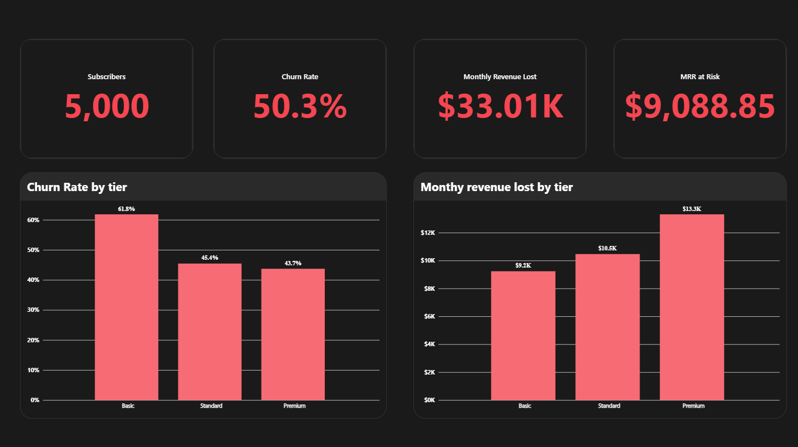
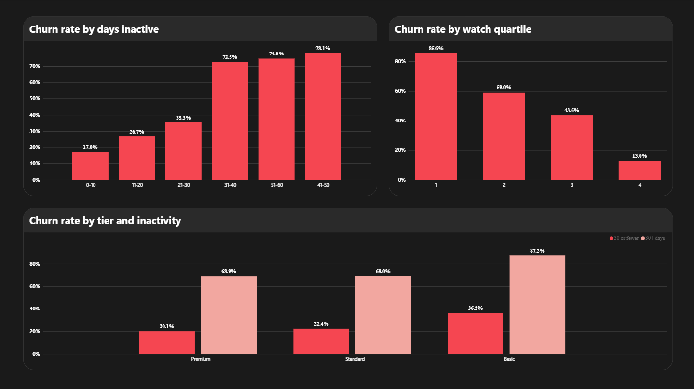
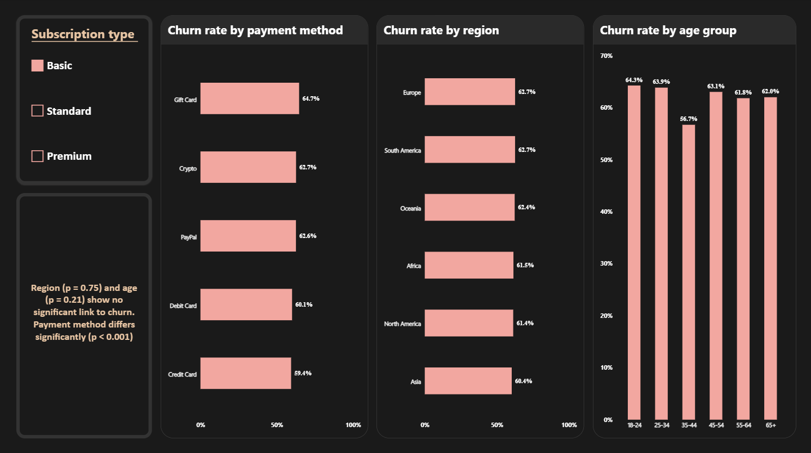
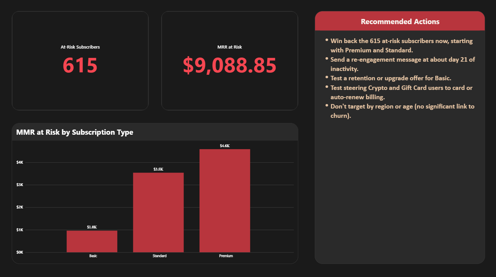

# Netflix Customer Churn Analysis

An end-to-end analysis of subscriber churn for 5,000 Netflix customers, using **MySQL**, **Python**, and **Power BI**. The goal: find which behaviors and customer segments are linked to cancellation, how much revenue is at risk, and what a retention team should do about it.

---

## Business question

Which subscribers are most likely to cancel, what behavior warns us early, and how much monthly revenue is at risk?

## Key findings

All results use the full 5,000 subscribers. 2,515 churned (50.3%).

| Factor | Result | Statistically significant? |
| --- | --- | --- |
| Days since last login | Churn is 26.1% at 30 days or fewer inactive, and 75.1% beyond 30 days | Yes (p < 0.001) |
| Watch time | Churn is 85.6% in the lowest watch-time quartile, and 13.0% in the highest | Not tested separately |
| Subscription tier | Basic 61.8%, Standard 45.4%, Premium 43.7% | Yes (p < 0.001) |
| Standard vs Premium | 45.4% vs 43.7% | No (p = 0.33) |
| Payment method | Crypto 59.7%, Gift Card 57.8%, PayPal 47.1%, Debit Card 43.7%, Credit Card 43.6% | Yes (p < 0.001) |
| Region | 48.3% (Africa) to 51.7% (Europe) | No (p = 0.75) |
| Age group | 48.6% (35-44) to 54.0% (45-54) | No (p = 0.21) |

**Highlights**

- **Inactivity is a clear tipping point.** Churn climbs gradually from 17.0% (0-10 days) to 35.3% (21-30 days), then doubles to 72.5% at 31-40 days. The pattern holds inside every tier.
- **Low engagement is the strongest warning sign.** The lowest watch-time quartile churns about 6.6 times as often as the highest.
- **Basic churns most, but Premium loses the most money.** Premium accounts for $13,312.60 of the $33,009.85 in monthly revenue lost (about 40%), because each cancellation costs $17.99 a month.
- **Crypto and Gift Card users churn 14 to 16 points more than Credit and Debit Card users**, even though their average fees and watch hours are almost identical.
- **Region and age show no clear link to churn** in this dataset.
- **615 active subscribers are at risk.** They haven't logged in for more than 30 days and represent **$9,088.85** in monthly revenue (255 Premium, 253 Standard, 107 Basic). About 89% of that revenue is Premium and Standard.

## Recommendations

1. **Win back the 615 at-risk active subscribers**, starting with Premium and Standard, who hold the most revenue.
2. **Trigger a re-engagement message at about day 21 of inactivity**, before subscribers cross the 30-day tipping point. Add a second trigger for very low watch time (under about 3.3 hours a month).
3. **Test a retention or upgrade offer for Basic subscribers**, who churn most even when they are active (36.2% vs 20% to 22% for other tiers).
4. **Test steering Crypto and Gift Card users toward card or auto-renew billing**, and measure whether churn falls.
5. **Don't build region-specific or age-specific campaigns** based on this data.

## Data

- **Source:** [https://www.kaggle.com/datasets/zeyadmohamed26/netflix-customer-churn-and-engagement-analytics]. Check the dataset's license before reusing the data.
- **Size:** 5,000 subscribers, 14 columns, no missing values, 5,000 unique customer IDs.
- **Columns:** `customer_id`, `age`, `gender`, `subscription_type`, `watch_hours`, `last_login_days`, `region`, `device`, `monthly_fee`, `churned`, `payment_method`, `number_of_profiles`, `avg_watch_time_per_day`, `favorite_genre`.
- **Target:** `churned` (0 = active, 1 = cancelled).

The dataset is curated. About half the subscribers churned, which is far higher than a real streaming service, so the findings describe this dataset, not Netflix itself.

### Data quality checks and issues

- **Row count:** 5,000 rows, 5,000 unique IDs, and a 50.30% churn rate, matching the dataset description.
- **Missing values:** none in `age`, `watch_hours`, `last_login_days`, or `churned`.
- **Tier and fee:** each tier has a single fee (Premium $17.99, Standard $13.99, Basic $8.99).
- **Import problem:** the MySQL Import Wizard first loaded only 4,271 of 5,000 rows with no error message. The cause was a `VARCHAR(10)` column for `favorite_genre`, which was too short for "Documentary" (11 characters). The wizard silently skips rows that don't fit. I widened the text columns, re-imported, and verified the row count before analyzing.
- **Data dictionary differences:** the dictionary lists the genre Thriller, but the file has Documentary instead. The minimum `watch_hours` is 0.01, not 0.10 as documented.
- **Inconsistent watch-time columns:** `watch_hours / 30` averages 0.39 hours a day, but `avg_watch_time_per_day` averages 0.87. Because they disagree, the analysis uses `watch_hours` only.

## Tools and methods

| Tool | Used for |
| --- | --- |
| MySQL | Data loading, validation, and analysis queries |
| Python (pandas, SciPy) | Chi-square tests of significance |
| Power BI | Four-page interactive dashboard |

**SQL techniques:** aggregation with `GROUP BY` and `HAVING`, `CASE` bucketing, window functions (`NTILE`, `RANK`), CTEs, and a reusable view.

### Example: the analysis view

```sql
CREATE VIEW churn_analysis AS
SELECT *,
  CASE WHEN last_login_days <= 10 THEN '0-10'
       WHEN last_login_days <= 20 THEN '11-20'
       WHEN last_login_days <= 30 THEN '21-30'
       WHEN last_login_days <= 40 THEN '31-40'
       WHEN last_login_days <= 50 THEN '41-50'
       ELSE '51-60' END AS inactivity_bucket,
  CASE WHEN age < 25 THEN '18-24'
       WHEN age < 35 THEN '25-34'
       WHEN age < 45 THEN '35-44'
       WHEN age < 55 THEN '45-54'
       WHEN age < 65 THEN '55-64'
       ELSE '65+' END AS age_group,
  NTILE(4) OVER (ORDER BY watch_hours) AS watch_quartile
FROM netflix_churn;
```

### Example: at-risk subscribers

"At risk" means **active subscribers (`churned = 0`) who haven't logged in for more than 30 days**, the point where churn roughly doubles in this dataset.

```sql
WITH at_risk AS (
  SELECT *
  FROM netflix_churn
  WHERE churned = 0 AND last_login_days > 30
)
SELECT subscription_type,
       COUNT(*) AS at_risk_subscribers,
       ROUND(SUM(monthly_fee), 2) AS monthly_revenue_at_risk
FROM at_risk
GROUP BY subscription_type
ORDER BY monthly_revenue_at_risk DESC;
```

This is a segment of subscribers who match the profile of those who cancelled. It is not a prediction that they will cancel.

## Dashboard

A four-page Power BI report:

1. **Overview:** total subscribers, churn rate, revenue lost, and revenue at risk, with churn and revenue lost by tier.
2. **Early warning:** churn by days inactive, by watch-time quartile, and by tier and inactivity together.
3. **Segments:** churn by payment method, region, and age group, with a tier filter.
4. **Recommendations:** at-risk subscribers, revenue at risk by tier, and the recommended actions.






A PDF export is in [`dashboard/dashboard.pdf`](dashboard/dashboard.pdf).

## Limitations

- **Association, not prediction.** The data has no dates, so it can't show that inactivity comes before cancelling. Results say "is associated with", not "predicts".
- **Curated dataset.** Findings describe this file, not the real Netflix subscriber base.
- **No lifetime value.** There is no tenure or start-date column, so customer lifetime value can't be calculated. Churn rate and monthly revenue are used instead.
- **Inconsistent watch-time columns.** Only `watch_hours` is used.
- **Data dictionary differences.** The file doesn't fully match its documentation (genre list, minimum watch hours).
- **The 30-day cutoff is a choice.** A different cutoff would change the at-risk totals.

## Repository structure

```
netflix-churn-analysis/
  README.md
  sql/
    01_setup_and_validate.sql
    02_analysis.sql
  notebooks/
    03_stats_check.ipynb
  dashboard/
    dashboard.pdf
    screenshots/
```

## How to reproduce

1. Download the dataset from the Kaggle link above.
2. In MySQL, run the table creation in `sql/01_setup_and_validate.sql`. Use wide text columns (for example `VARCHAR(30)`), because the file has values longer than the data dictionary suggests.
3. Load the CSV with the Table Data Import Wizard into the existing table, then check you have 5,000 rows, 5,000 unique IDs, and 2,515 churned subscribers before going further.
4. Run the rest of `01_setup_and_validate.sql` (validation checks and the `churn_analysis` view), then `02_analysis.sql`.
5. Open `notebooks/03_stats_check.ipynb` in Google Colab or Jupyter to run the chi-square tests.
6. For the dashboard, export the `churn_analysis` view as `churn_analysis.csv` (with the row limit off) and load it into Power BI Desktop.

## Author

**Ateeya Cali**, data analyst. [GitHub](https://github.com/kamjanyang)
